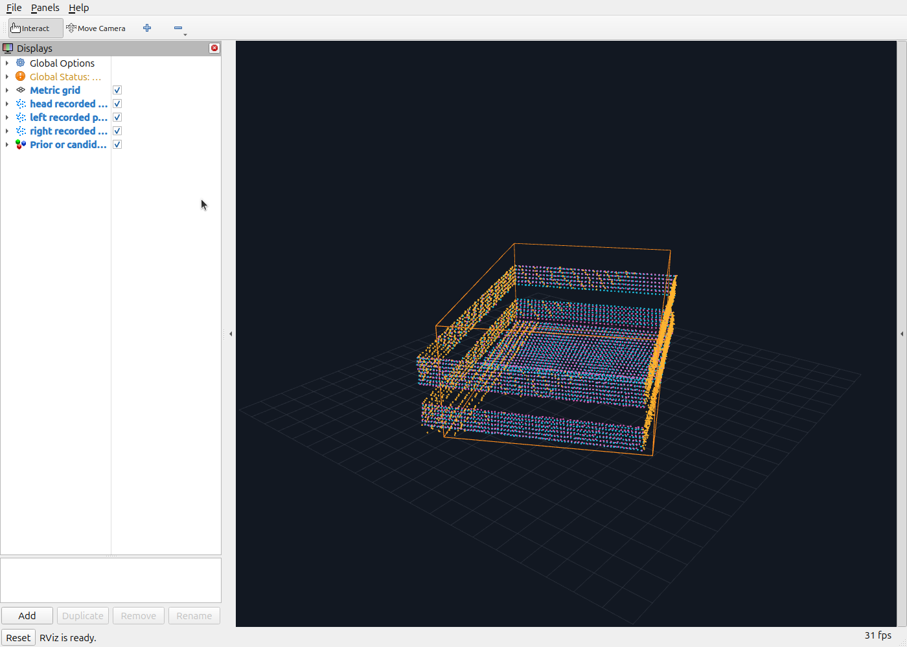
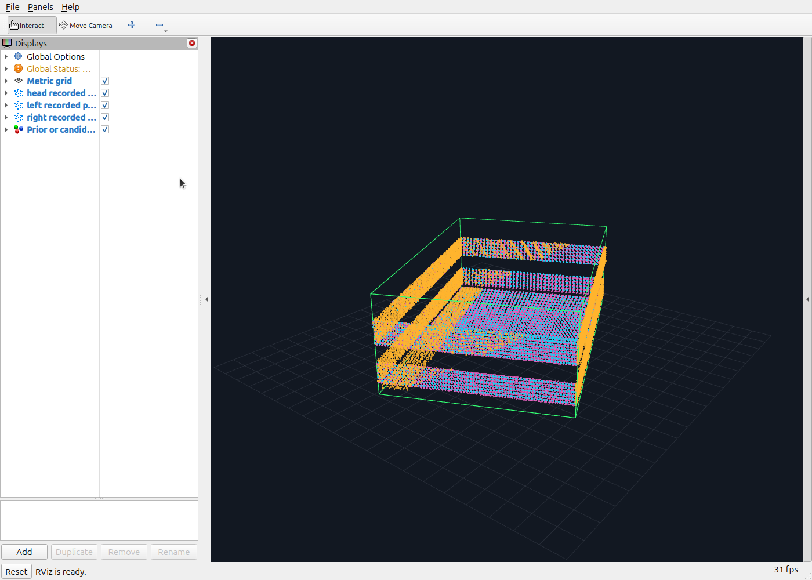
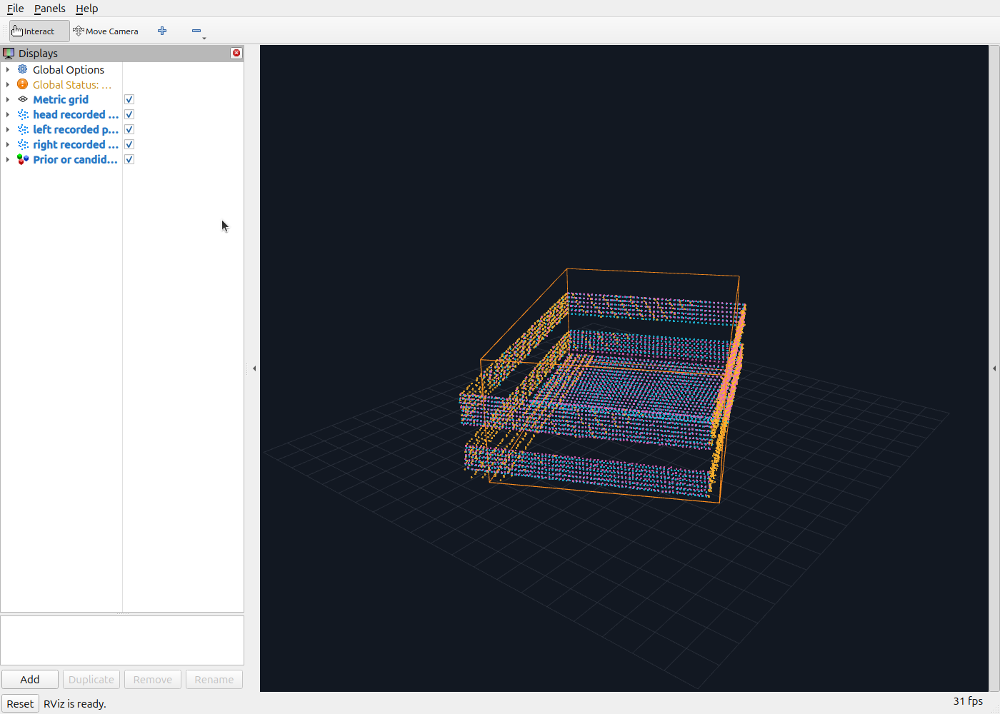
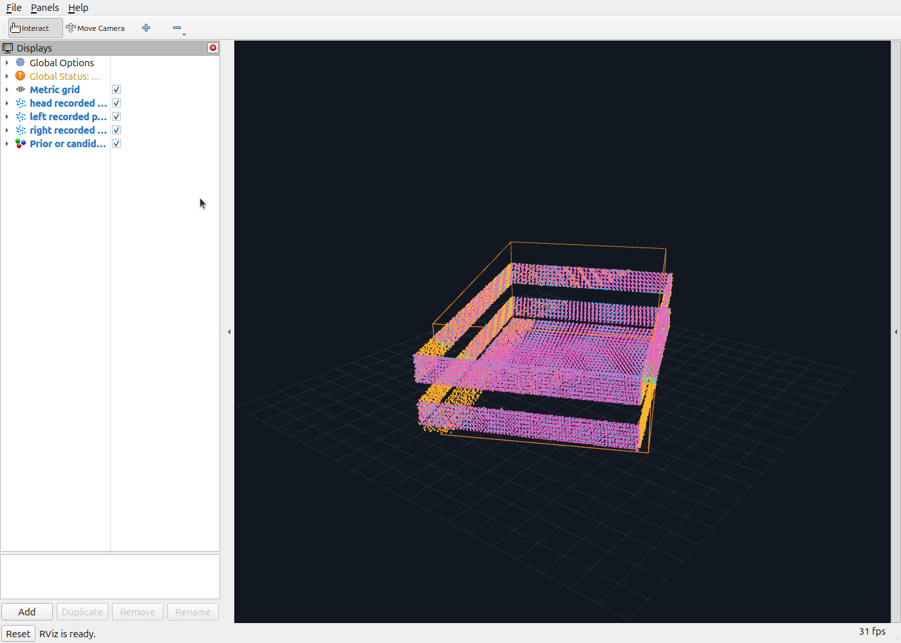

# Tote fusion

ROS 2 packages for bounded, model-based tote pose estimation and observable width/length refinement from registered RGB-D observations. A C++17 geometry core fits an immutable tote model; the ROS adapter collects masked depth from up to three cameras, transforms each observation at its acquisition time, validates the fit and publishes a **candidate**. Simulator truth is never an estimator input.

**Current scope: ROS 2 Jazzy simulation profiles.** The node requires `use_sim_time=true` and `/clock`. Hardware operation and calibrated uncertainty remain future work. The package does not control robot motion, run segmentation, commit model revisions, or publish a fused/denoised point cloud.

## Noisy accepted versus noisy rejected

These are actual RViz screenshots of exported observations from the recorded M3 analytic RGB-D corpus. Cyan is the head camera, gold the left wrist, pink the right wrist. The same camera view and point styling are used throughout. Orange outlines the nominal prior; green outlines the accepted pose and proposed outer dimensions. The wireframe is an outer envelope, not the full compound collision model.

| Recorded request | Before fusion: one capture per camera | After collection/fusion: six captures per camera |
| --- | --- | --- |
| **Accepted** — seed 3093, `OK` | [](docs/images/noisy-accepted-before.png) | [](docs/images/noisy-accepted-after.png) |
| **Rejected** — seed 3090, `INSUFFICIENT_GEOMETRY` | [](docs/images/noisy-rejected-before.png) | [](docs/images/noisy-rejected-after.png) |

“After” displays the union of capture-time body-frame points and, on acceptance, the fitted model. Points are **not denoised, moved onto surfaces, or filled in**. Both requests contain 18 admitted frames; admission is distinct from accepting the final estimate. The rejected request returned `Held-out camera dimension lacks fitting support`. Its orange prior is reference geometry only, not a successful estimate. A visually plausible cloud can lack the independent endpoint evidence needed to support a dimension.

The accepted candidate proposes length **620.035 mm**, width **420.576 mm**, and unchanged nominal height **230 mm**. Its held-out point RMSE is **1.612 mm**. Local covariance remains uncalibrated and conditional on the π-yaw equivalence class and unresolved geometry. These two examples are illustrative, not a success-rate claim.

The cameras had injected depth noise of 1.5/2/2.5 mm plus independent camera/frame bias, with declared fit weights of 3/4/5 mm. Masks were generated by the test fixture. These are simulated recorded observations, not hardware measurements or Gazebo-rendered screenshot data. [Exported clouds and saved action results](evidence/clouds/provenance.json) preserve acquisition stamps, counts and original bag/report SHA-256 hashes. The large original recording remains in the development workspace; the compact point exports are included here.

## Build and verify

Tested on Ubuntu 24.04, ROS 2 Jazzy, GCC 13 and Eigen 3.4. Start with a sourced ROS installation and `rosdep`/`colcon` installed:

```bash
mkdir -p ~/tote_fusion_ws/src
cd ~/tote_fusion_ws/src
git clone https://github.com/renatto-tommasi/tote-fusion.git
cd ~/tote_fusion_ws
source /opt/ros/jazzy/setup.bash
rosdep install --from-paths src --ignore-src -r -y
colcon build --packages-select tote_fusion_interfaces tote_fusion --symlink-install \
  --cmake-args -DBUILD_TESTING=ON -DCMAKE_BUILD_TYPE=RelWithDebInfo \
  '-DCMAKE_CXX_FLAGS_RELWITHDEBINFO=-O2 -g'
source install/setup.bash
colcon test --packages-select tote_fusion_interfaces tote_fusion \
  --event-handlers console_cohesion+
colcon test-result --all
```

The explicit compiler flags keep internal assertions active in the optimized build. External inputs also receive release-active validation. The included launch tests provide their own simulated clock, sensor observations and minimal robot TF fixtures; no Avatar simulator workspace is needed to run them. To operate the node outside those tests, supply the clock, calibrated camera streams, masks and acquisition-time TF yourself.

Repository layout:

- [`src/tote_fusion`](src/tote_fusion): estimator, model/configuration, launch file and tests.
- [`src/tote_fusion_interfaces`](src/tote_fusion_interfaces): action and candidate message definitions.
- [`docs/milestones.md`](docs/milestones.md): implemented milestones, review findings and evidence scope.
- [`docs/lessons_learned.md`](docs/lessons_learned.md): engineering lessons from the development workspace.
- [`TOTE_FUSION_NODE_SPEC.md`](TOTE_FUSION_NODE_SPEC.md) and [`docs/design_decisions.md`](docs/design_decisions.md): design contract and decisions.

## Launch and request an estimate

Choose a profile deliberately. Strict profiles reject unresolved nominal π-yaw symmetry. A `*_pi_equivalent` profile permits that ambiguity only when the consumer explicitly supports both equivalent poses.

| Profile | Selected cameras | Action mode | Estimated state |
| --- | --- | --- | --- |
| `head_sim_strict` / `head_sim_pi_equivalent` | `head` | `0` (`POSE_ONLY`) | Pose, fixed geometry |
| `multi_sim_strict` / `multi_sim_pi_equivalent` | Two or three configured IDs | `0` (`POSE_ONLY`) | Joint pose, fixed geometry |
| `geometry_sim_strict` / `geometry_sim_pi_equivalent` | One to three configured IDs | `1` (`POSE_AND_GEOMETRY`) | Pose and supported width/length changes |

Example for three cameras, with an explicit symmetry policy:

```bash
ros2 launch tote_fusion tote_fusion.launch.py \
  camera_ids:=head,left,right \
  validation_profile:=geometry_sim_pi_equivalent \
  candidate_validity_s:=2.0
```

In another sourced terminal, after `/clock` is advancing and the sensor/TF streams are ready:

```bash
ros2 action send_goal /tote_fusion/estimate tote_fusion_interfaces/action/EstimateTote \
  "{object_id: tote_001, expected_model_revision: 0, collection_duration: {sec: 1, nanosec: 200000000}, min_distinct_views: 2, mode: 1, validation_profile: geometry_sim_pi_equivalent}" \
  --feedback
```

For head-only pose estimation, launch with `camera_ids:=head validation_profile:=head_sim_pi_equivalent`; send mode `0`, that same profile, `min_distinct_views: 1` and a bounded collection duration. The shipped model has exercise revision `0`; use the revision of your actual immutable snapshot. `min_distinct_views` counts participating **camera IDs**, not robot poses or time samples. Each participating camera needs separate acquisition samples. Collection duration must be 0.1 seconds to `max_capture_window_s` (default 2 seconds).

One request runs at a time. Results include an explicit success flag, code, message, frame counts and candidate on success; failures publish no new candidate. Initial invalid/busy/stale goals are rejected before execution, with details on `/diagnostics`. An action client should cancel via the ROS action protocol before abandoning a request. Collection, memory and steady-wall-time bounds also apply if simulation time stalls.

## Input topics and calibration

Edit a copy of [`src/tote_fusion/config/cameras.yaml`](src/tote_fusion/config/cameras.yaml), then pass its absolute path as `camera_file`. The bundled catalog is a simulation example; its noise assumptions are not hardware calibration.

| ID | Registered depth (`sensor_msgs/Image`) | Registered calibration (`sensor_msgs/CameraInfo`) | Tote mask (`sensor_msgs/Image`) | Optical frame |
| --- | --- | --- | --- | --- |
| `head` | `/head_front_camera/depth/image_rect_raw` | `/head_front_camera/depth/camera_info` | `/tote_segmentation/head/mask` | `head_front_camera_depth_optical_frame` |
| `left` | `/tote_sensors/left/depth/image_rect_raw` | `/tote_sensors/left/depth/camera_info` | `/tote_segmentation/left/mask` | `wrist_left_camera_depth_optical_frame` |
| `right` | `/tote_sensors/right/depth/image_rect_raw` | `/tote_sensors/right/depth/camera_info` | `/tote_segmentation/right/mask` | `wrist_right_camera_depth_optical_frame` |

```bash
cp "$(ros2 pkg prefix tote_fusion)/share/tote_fusion/config/cameras.yaml" ~/tote-cameras.yaml
# Edit depth_topic, camera_info_topic, mask_topic, optical_frame and noise_sigma_m.
ros2 launch tote_fusion tote_fusion.launch.py \
  camera_file:="$HOME/tote-cameras.yaml" camera_ids:=head,left,right \
  validation_profile:=geometry_sim_pi_equivalent
```

Configuration is immutable while the node is running: restart after changing topics, calibration assumptions, profile or model. `model_file:=/absolute/path/tote_model.yaml` selects the prior pose, body frame, revision and geometry hash; keep its referenced geometry file alongside it. The shipped prior is local to the demonstration, not a universal tote location.

For direct node invocation, camera fields are also ROS parameters. Head uses `depth_topic`, `mask_topic`, `camera_info_topic`, `optical_frame`, `noise_sigma_m`; other IDs use prefixes such as `left.depth_topic` and `right.noise_sigma_m`. `camera_ids` selects entries from the catalog. Unknown parameters, repeated frames/topics and invalid numerical configuration fail loudly.

The input contract is strict:

- Depth is registered **axial Z**, `32FC1` metres or `16UC1` millimetres. The `mono8` mask selects tote pixels; it must match depth dimensions, optical frame and acquisition stamp. CameraInfo must describe that same registered, undistorted pinhole image. Unregistered RGB calibration or a segmentation model's resized mask is insufficient.
- Depth, mask and CameraInfo timestamps must match exactly within each camera. The estimator uses masked finite depths in the configured range (default 0.3–3 m). Supply real segmentation upstream; the package includes no production segmentation network.
- Supply `/tf` and `/tf_static` so the configured body frame is an ancestor of each optical frame. Dynamic TF must have exact acquisition-time support or bracketing samples within the configured gap/support-age limits (both default 100 ms). Deliver TF support before the complete observation is admitted. There is no substitution of latest TF.
- Supply `/clock` and fresh observations in that clock domain. The tote must remain stationary relative to the body frame throughout one request; articulated cameras may move when their acquisition-time TF is valid. Keep acquisition conditions within the validated sensor profile.

Sensor subscriptions default to best-effort. For a reliable recorded-data publisher, `reliable_sensor_qos:=True` is available; ensure the offered publisher QoS is compatible.

## Output topics and action remapping

| Endpoint | Type | Meaning |
| --- | --- | --- |
| `/tote_fusion/estimate` | `tote_fusion_interfaces/action/EstimateTote` | Bounded request, feedback, cancellation and terminal result |
| `/tote_fusion/candidate` | `tote_fusion_interfaces/msg/TotePoseCandidate` | Successful pose/model proposal, never an automatic commit |
| `/diagnostics` | `diagnostic_msgs/msg/DiagnosticArray` | Admission errors, state and rejection details |

Output names and the action base name use standard ROS remapping. For example, this direct invocation remaps all three endpoints:

```bash
ros2 run tote_fusion tote_fusion_node --ros-args \
  -p use_sim_time:=true \
  -p model_file:="$(ros2 pkg prefix tote_fusion)/share/tote_fusion/config/tote_model.yaml" \
  -p camera_ids:="[head, left, right]" \
  -p validation_profile:=geometry_sim_pi_equivalent \
  -r /tote_fusion/candidate:=/robot/tote/candidate \
  -r /tote_fusion/estimate:=/robot/tote/estimate \
  -r /diagnostics:=/robot/tote/diagnostics
```

Send goals to `/robot/tote/estimate` in that example. A custom launch file can set the same `Node(remappings=[...])` pairs. The bundled launch file exposes input/configuration arguments; it does not expose output-remapping launch arguments. ROS namespaces alone do not change these absolute names. The documentation viewer's `/documentation/*` point topics are visualization aids, not estimator outputs.

## Consume a candidate

Check schema, object ID, parent revision and geometry hash, capture interval, `valid_until`, calibration IDs, source/missing cameras, ambiguity status, observable parameters and unresolved geometry before using a proposal. `DEGRADED_OK` explicitly reports missing configured cameras when the requested minimum and validation gates still pass. It does not mean silently reconstructed camera data.

M3 candidates carry a joint pose/dimension covariance, proposed geometry hash, nominal assumptions for the inner opening, and a conditional collision envelope. Width/length refinement requires supported physical boundaries with independent fitting/held-out evidence; image crops do not count as physical tote edges. Height, wall thickness, underside and hidden defects remain unresolved. The covariance/envelope cannot certify collision safety on hardware.

An external model manager/consumer must validate the proposal and own the commit decision, model distribution and restart with a new immutable revision. No model-manager implementation or commit endpoint is included in these two packages; the node never edits the input snapshot. A prior or last accepted topic sample is not automatically a current observation; enforce object identity and expiry even after a later rejection.

## What the robot should do after rejection

The external controller owns recovery. Inspect the result code/message and diagnostics, finish or cancel the active request, then choose a bounded corrective action. Do not execute a grasp or commit geometry from a rejected result. Set a retry limit and escalate persistent failures to an operator or a separate perception procedure.

| Rejection or condition | Recommended external response |
| --- | --- |
| `INSUFFICIENT_DATA`, `INSUFFICIENT_GEOMETRY`, `UNOBSERVABLE` | Check valid synchronized frames and masks first. Move head/wrist cameras to reveal opposing physical endpoints and nonparallel walls plus a floor/support surface. Avoid cropped edges, occlusion and grazing views; settle, obtain fresh TF/calibration and request a new bounded collection. More points from the same uninformative view do not establish observability. |
| `CAMERA_CONFLICT`, `GEOMETRY_CONFLICT` | Compare camera-specific evidence. Inspect extrinsic/intrinsic calibration, clock alignment, registration, depth units and segmentation. Recalibrate a suspect camera against an independently known target; restart with the validated immutable configuration. Confirm genuine box variation only after calibration and physical boundary support are established. Do not average conflicting sensors or inflate declared noise to force acceptance. |
| `POOR_FIT` | Check the prior's local convergence region, model identity, masking, occlusion and depth artifacts. Obtain clearer views or provide a separately validated prior before retrying. A guessed pose/dimension is not a successful estimate. |
| `TF_UNAVAILABLE`, `TF_CHANGED`, calibration changes, invalid metadata, clock reset or stale observations | Repair TF/time/sensor publication and synchronization. Wait for valid acquisition-time support and fresh matched triples; restart when configuration/calibration changes. After a reset, wait for a positive advancing clock. Do not substitute latest TF or mix data across resets/calibration changes. |
| Strict-profile π-yaw ambiguity | Symmetric additional views alone cannot resolve symmetric geometry. Use independent orientation/asymmetric evidence with a separately validated model, or explicitly permit the π-equivalence class only when the task/consumer supports both poses. |
| Stale model revision, expired candidate, cancellation, timeout or busy server | Refresh the actual model snapshot/revision and reject expired observations; wait for the previous terminal state before another request. Diagnose missing streams or exceeded workload bounds before retrying. |

**Base motion requires a new frame-consistent prior.** During a request, moving the base changes the tote pose in `base_link`, violating the stationary-object assumption. Finish/cancel collection, use the robot's normal collision-checked planner to reposition, settle, transform an independently validated world/object prior into the new body frame, and restart with that immutable snapshot. Do not combine pre/post-base-motion observations or reuse an old body-relative prior as if it were current. This package does not provide that motion/planning/prior-refresh integration.

Better views and recalibration are decisions based on the actual failure. Repeatedly relaxing residual/observability gates hides defects and is not a recovery policy. The simulation-only profile must be extended and independently validated before applying this workflow on physical hardware.

## Evidence, milestones and remaining limits

M1 established head-camera pose candidates, strict time/TF/input contracts and bounded request/cancel/failure behavior. M2 added multi-camera fusion, per-camera noise and consistency checks, missing-camera reporting and camera-held-out validation. M3 added observable width/length refinement, joint uncertainty, immutable model revision validation and conditional collision geometry. [Milestone notes](docs/milestones.md), [independent M1/M2 review](docs/review_m1_m2.md) and [independent M3 review](docs/review_m3.md) retain implementation findings and lessons.

The final development package reported **84 checks, zero errors/failures** (individual cases plus test wrappers). The public checkout is also built/tested independently from the ROS underlay; see [`evidence/standalone-tests.log`](evidence/standalone-tests.log). Historical evaluation and mutation summaries are in [`evidence`](evidence); historical workspace paths identify original artifacts, not files promised in this repository.

M3's realistic-resolution action corpus accepted **60/60 clean** and **21/60 noisy** requests across two/three-camera workloads. The other **39 noisy requests were rejected**. Maximum accepted width/length errors were 0.576/0.278 mm in this finite simulated population; errors are reported only for accepted estimates. Historical M2 pose-only and synthetic core results are different workloads, not interchangeable success rates. M3 uncertainty is explicitly conditional and uncalibrated; shared calibration bias, real segmentation, hardware accuracy, large-motion convergence and production timing remain unestablished. See [M3 evaluation](evidence/m3-evaluation.json) and [M2 evaluation](evidence/m2-evaluation.json).

To reopen a recorded cloud locally, install RViz and the Python NumPy/YAML ROS dependencies, source this workspace, then run:

```bash
export ROS_DOMAIN_ID=94  # Use an isolated, unused documentation domain.
rviz2 -d tools/clouds.rviz
# In another terminal, with the same domain and sourced ROS environment:
python3 tools/cloud_viewer.py --clouds evidence/clouds \
  --model src/tote_fusion/config/tote_model.yaml --case accepted --stage after
```

Use `--case rejected` and/or `--stage before` for the other panels. Run from the cloned repository root. The viewer only republishes the included recorded point exports; it has no robot-control or estimator link. [`tools/recorded_clouds.py`](tools/recorded_clouds.py) documents the original bag-to-point export and requires the original recording/report to regenerate the exports.

The completed [robotics README review](docs/robotics-readme-review.md) checked the operational guidance, commands, images and evidence against the shipped implementation; no blocking documentation findings remain.

## License and attribution

Code is [Apache-2.0](LICENSE), matching the package metadata. EU6423 geometry is adapted from Daniel Rosehill's Industrial Storage Unit 3D Models under **CC BY 4.0**; preserve [`ATTRIBUTION.txt`](src/tote_fusion/config/ATTRIBUTION.txt). Geometry licensing is distinct from the code license.
