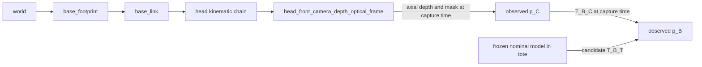

# Frames and timestamps

`T_A_B` maps B coordinates into A. Distances are metres; rotations are radians.
The estimator reference is `B = base_link`. The tote frame `T = tote` has its
origin at the horizontal centre of the bottom contact plane, X along length,
Y along width, and Z up. `tote_base` in CAD is an identity alias of this frame;
it must not become a shared simulator-truth transform.



The world-to-base path is **robot** placement/kinematics, not tote truth.
In the warehouse profile, `T_world_base_footprint` has zero translation and
rotation, and the URDF places `base_link` 0.0762 m above `base_footprint`.
Do not substitute the standalone stationary launch's default 0.02 m base height.
The M0 snapshot derives this path from the bag's `/tf_static` and verifies it
has not changed. Under these measured stationary transforms, the independent
world prior `(1.040, 0, 0.600)` m becomes `(1.040, 0, 0.5238)` m in `base_link`;
the 28 degree yaw is unchanged. Recompute from robot TF after any placement
change. Never obtain this conversion from a simulator tote query.

For pixel `(u,v)` and validated axial optical depth Z:

```
p_C = [(u-cx)*Z/fx, (v-cy)*Z/fy, Z]
p_B = T_B_C(t_capture) p_C
T_B_T_prior = inverse(T_world_B) T_world_T_prior
T_world_T_candidate = T_world_B(t_capture) T_B_T_candidate
```

The final equation is for the **test evaluator** adapter only. The estimator
publishes candidates in `base_link` and does not depend on evaluator outputs.
Optical axes are X/right, Y/down, Z/forward. Registered RGB and corrected
CameraInfo share the head depth optical frame. The interface adapter already
converts Gazebo point-cloud axes and subtracts 0.5 pixel from raw principal
points. The estimator uses validated depth/CameraInfo, without repeating those
backend-specific corrections.

Image/mask/CameraInfo acquisition stamps use ROS simulation time. Obtain TF at
the depth acquisition stamp; retain that stamp, frame and calibration identity
after transformation. Static TF does not require a recent publication stamp.
For M2 moving wrists, dynamic-transform interpolation/age/extrapolation checks
must be tested at capture time. Do not use current/latest TF as a fallback.

M1 must document candidate header capture-time semantics, first/last capture
interval, issue time, validity/expiry and separate wall-time processing metrics.
A simulation-time reset invalidates an in-flight request. Keep acquisition
time and steady wall-clock deadlines separate; a stalled `/clock` must not
disable cancellation or bounded timeouts.

The bag allowlist contains head sensors, mask, robot description/TF, clock and
the independent planning prototype. Physical tote poses, instance IDs, truth
labels and evaluator reports remain outside it. Geometry is a nominal planner
input, not an observation of the physical tote.
